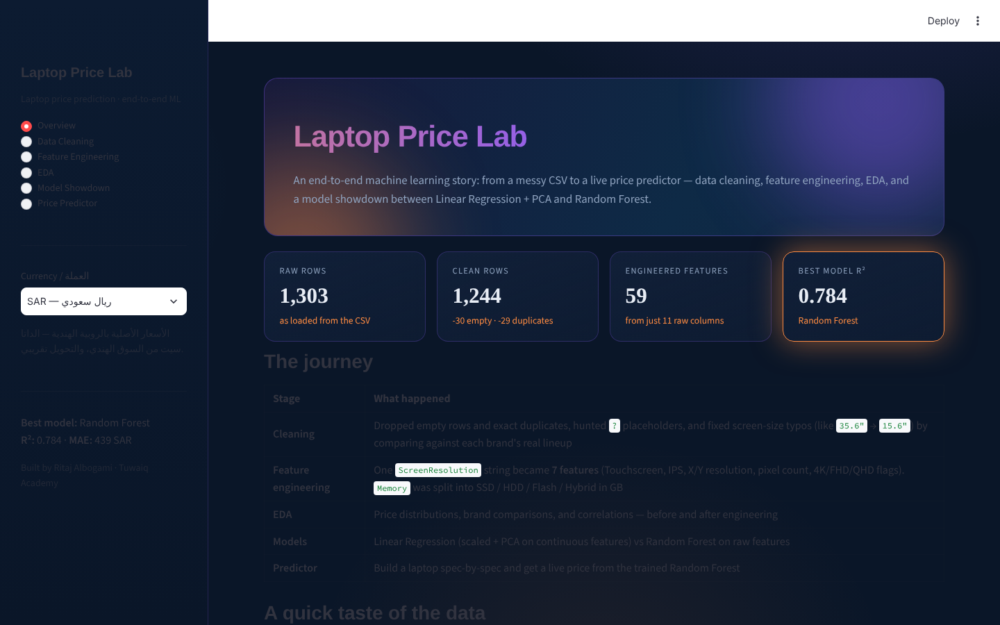

# Laptop Price Lab

An end-to-end machine learning project that predicts laptop prices from their specifications, delivered as an interactive Streamlit dashboard.

## The dashboard



Six pages that follow the ML workflow from raw data to a prediction:

**Overview · Data Cleaning · Feature Engineering · EDA · Model Showdown · Price Predictor**

## Approach

- **Data cleaning:** 1,303 raw rows → 1,244 clean rows (empty rows and exact duplicates dropped, `?` placeholders handled, screen-size typos fixed against each brand's real lineup).
- **Feature engineering:** 59 features from 11 raw columns. For example, the screen-resolution string becomes 7 features (touchscreen, IPS, X/Y resolution, pixel count, 4K/FHD/QHD flags) and storage is split into SSD / HDD / Flash / Hybrid.
- **Model showdown:** Linear Regression (scaled features + PCA keeping 95% of the variance) against a Random Forest (300 trees, depth 20) on the raw features. The **Random Forest wins with R² 0.784**.
- **Price predictor:** enter a configuration and get an estimated price. Prices are in Indian rupees (the dataset comes from the Indian market); a sidebar switch shows an approximate conversion to SAR or USD.

## Run it

```bash
cd laptop_ml
pip install -r requirements.txt
streamlit run app.py
```

**Tech:** Python · pandas · scikit-learn · Plotly · Streamlit

**Author:** Ritaj Albogami — Tuwaiq Academy AI & Data Science Diploma, 2026.
